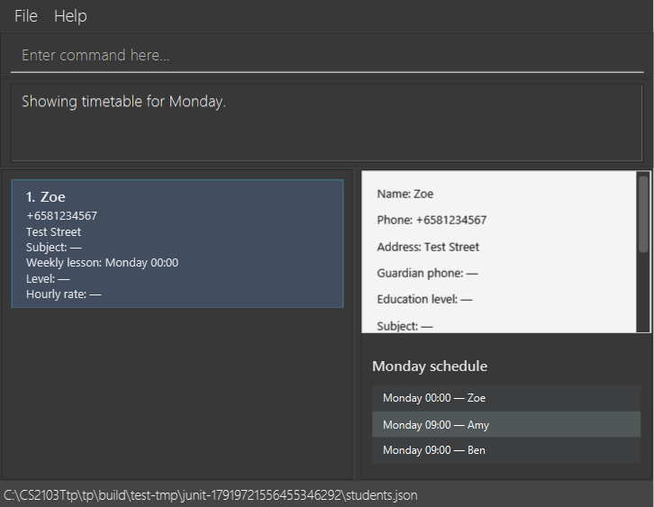

[](https://github.com/AY2627S1-CS2103T-F08-3/tp/actions/workflows/gradle.yml)
[](https://codecov.io/gh/AY2627S1-CS2103T-F08-3/tp)



# TutorConnect

**TutorConnect** is a desktop application designed for **freelance private tutors** to organise student contacts, track lesson schedules, and manage parent communications. Optimized for fast typists, it combines the speed of a Command Line Interface (CLI) with the convenience of a Graphical User Interface (GUI).

* **Target User:** Freelance private tutors managing multiple students and parents across different academic levels.
* **Fast Keyboard-Driven Workflow:** Add records, update lesson notes, and query schedules without touching a mouse.
* **Organised Directories:** Group students by subject, grade level, and recurring time slots.
* For the detailed documentation of this project, see the **[TutorConnect Product Website](https://ay2627s1-cs2103t-f08-3.github.io/tp/)**.
* If you are interested in using TutorConnect, see the **[User Guide](docs/UserGuide.md)**.
* If you are interested in contributing or extending this project, see the **[Developer Guide](docs/DeveloperGuide.md)**.

---

## Build and launch from a terminal

Install **JDK 25 with JavaFX** (the same Zulu JDK+FX distribution used in CI),
set `JAVA_HOME` to its installation folder, and open a terminal in the repository.
No separate Gradle installation is needed; use the checked-in wrapper.

```sh
./gradlew run
```

This opens the desktop window. Enter student commands in that window, not in
the terminal. Close the window or enter `exit` in its command box to quit.

```sh
./gradlew build
java -jar build/libs/tutorconnect.jar
```

`build` runs tests, Checkstyle and executable-JAR checks and creates the JAR.
On Windows, use `gradlew.bat` instead of `./gradlew`. See the
[terminal setup guide](docs/SettingUp.md#building-and-running-from-a-terminal)
for Java selection, desktop test flags and data-directory precautions.

* This project is based on the AddressBook-Level3 project created by the [SE-EDU initiative](https://se-education.org).
