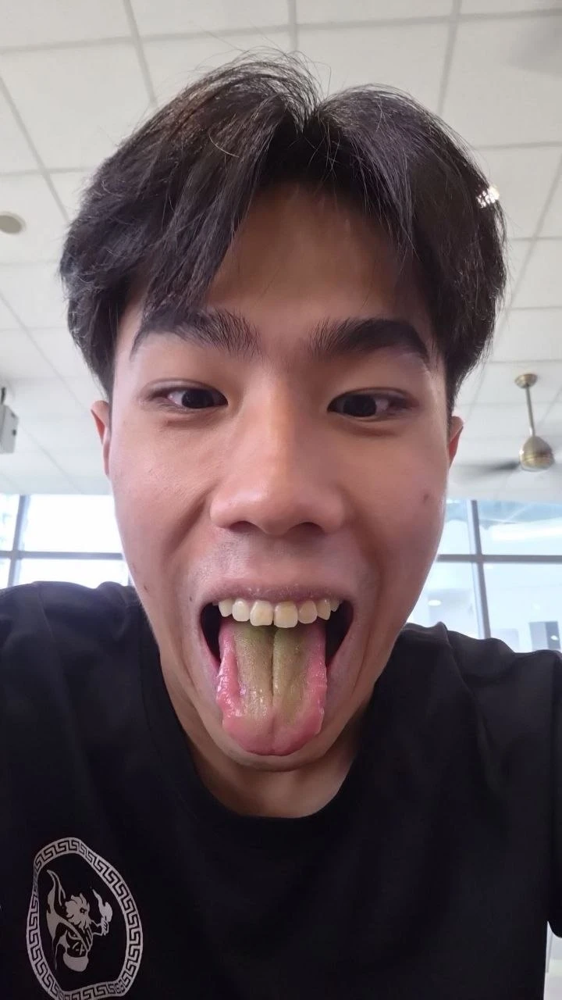
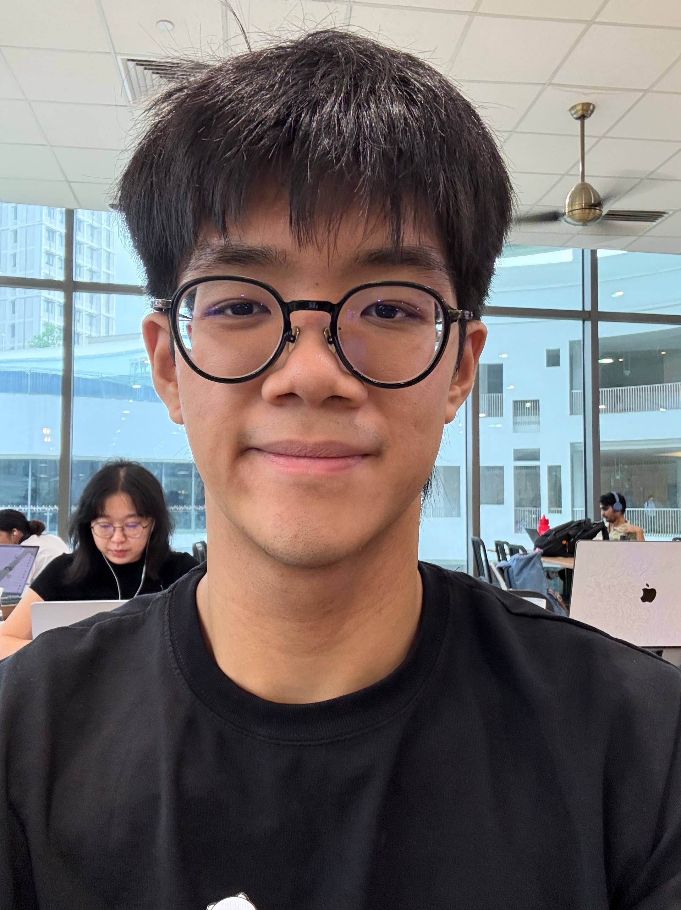

# About Us

We are a team based in the [School of Computing, National University of Singapore](https://www.comp.nus.edu.sg).

Contact the TutorConnect team through our [GitHub issue tracker](https://github.com/AY2627S1-CS2103T-F08-3/tp/issues).

## Project team

### Anton Ang Jia Jun

[[github](https://github.com/Antz5lyfe)]
[[portfolio](team/antz5lyfe.md)]

* Role: Developer
* Responsibilities: Weekly scheduling, contact editing and hourly rates

### Kiefer Lau

[[github](https://github.com/keyfurrr67)]
[[portfolio](team/keyfurrr67.md)]

* Role: Developer
* Responsibilities: Education levels, subjects and academic records

### Eugene

[[github](https://github.com/YUJ1N06)]
[[portfolio](team/yuj1n06.md)]

* Role: Developer
* Responsibilities: Shared infrastructure, persistence, scheduling integration and builds

### Jimi Bong

[[github](https://github.com/JimiBong)]
[[portfolio](team/jimibong.md)]

* Role: Developer
* Responsibilities: Student deletion and discovery, integration testing and release readiness

### Aishwarai Pratiksha

[[github](https://github.com/ap-was-here)]
[[portfolio](team/ap-was-here.md)]

* Role: Developer
* Responsibilities: Guardian contacts, subject verification and monthly payments
