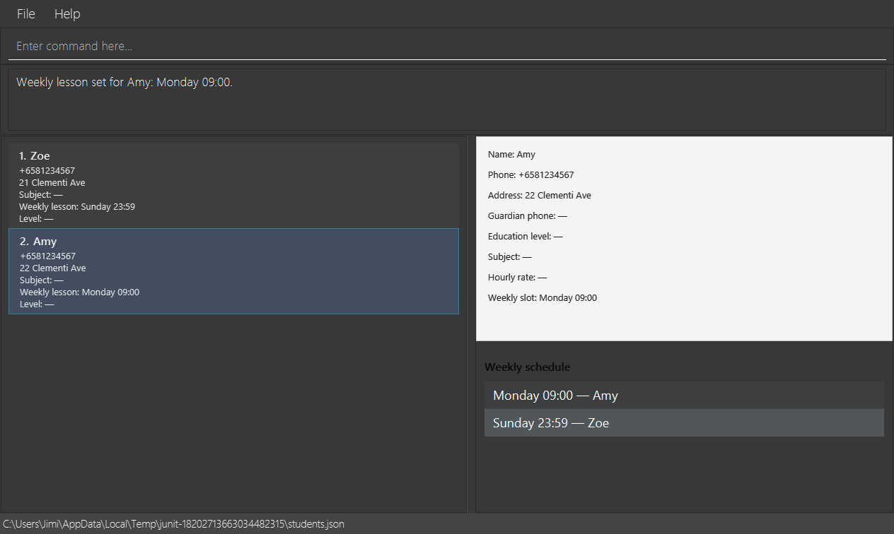
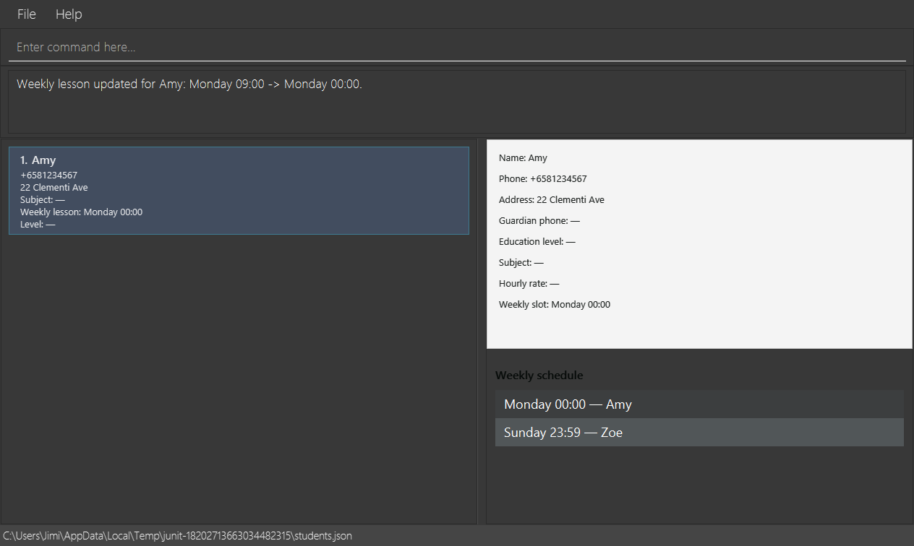
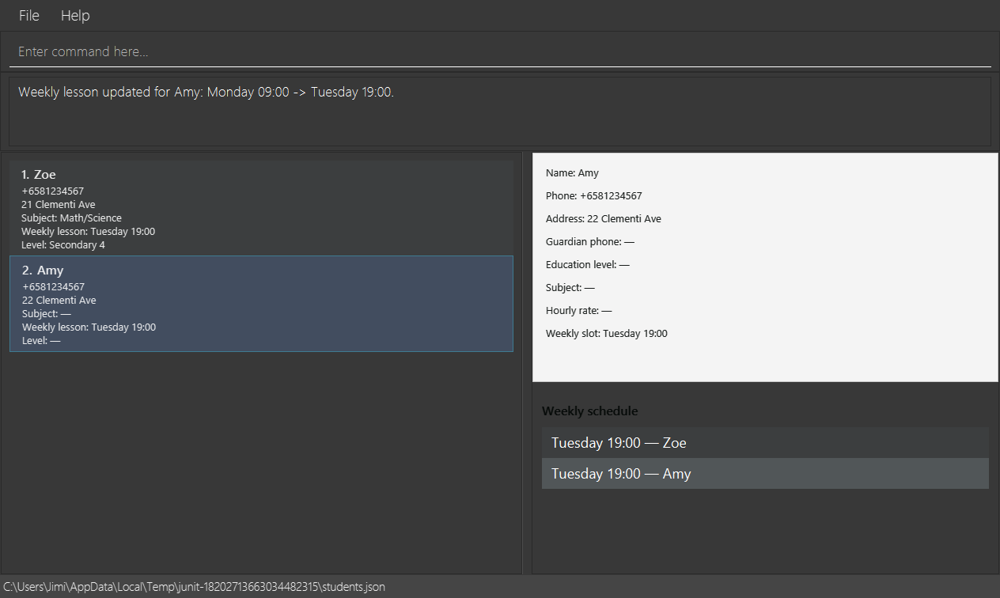
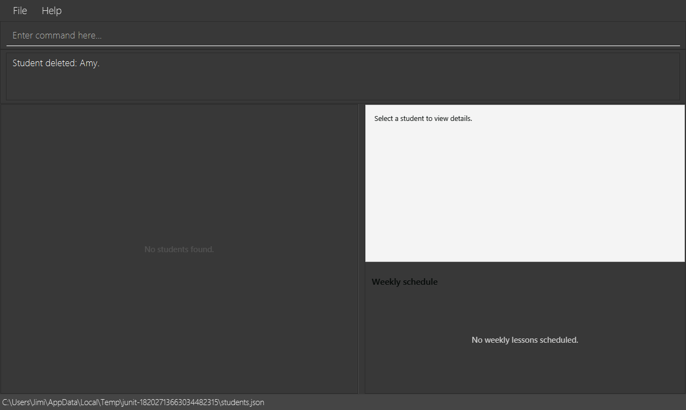

# Testing guide

<!-- * Table of Contents -->
<page-nav-print />

<!-- -------------------------------------------------------------------------------------------------------------------- -->

## Running tests

You can run tests in two ways.

* **Method 1: Using IntelliJ JUnit test runner**
  * To run all tests, right-click on the `src/test/java` folder and choose `Run 'All Tests'`
  * To run a subset of tests, you can right-click on a test package,
    test class, or a test and choose `Run 'ABC'`
* **Method 2: Using Gradle**
  * Open a console and run the command `gradlew clean test` (Mac/Linux: `./gradlew clean test`)

<box type="info" seamless>

**Link**: Read [this Gradle Tutorial from the se-edu/guides](https://se-education.org/guides/tutorials/gradle.html) to learn more about using Gradle.
</box>

--------------------------------------------------------------------------------------------------------------------

## Types of tests

Command cleanup regressions retain the existing owner suites. `ArgumentTokenizerTest` additionally checks
the legacy edit grammar's ASCII-space boundaries, embedded slashes, unknown prefixes and empty values.
`StudentFieldIntegrationTest` checks clearing a selected filtered record, saving/reloading an empty register,
repeated clearing, and atomic failure preservation. `AddStudentUiTest` verifies failed clearing retains the
selected row/details and successful clearing resets both through the real command box.

This project has three types of tests:

1. *Unit tests* target the lowest-level methods and classes.<br>
   For example: `tutorconnect.commons.util.StringUtilTest`
1. *Integration tests* check how multiple code units work together; the individual units are assumed to work.<br>
   For example: `tutorconnect.storage.StorageManagerTest`
1. *Hybrid tests* combine unit and integration testing. These tests check both the individual units and how they work together.<br>
   For example: `tutorconnect.logic.LogicManagerTest`

## F01–F08 acceptance

Student discovery (F03, stories 10 and 15) adds focused `FindCommandParserTest`,
`NameContainsKeywordsPredicateTest`, `FilterCommandParserTest`, `FilterCommandTest` and
`StudentCriteriaPredicateTest` coverage. Run `StudentDiscoveryIntegrationTest` for real command parsing,
full-register query replacement, all seven indexed mutation targets and persisted UUIDs, no-save queries,
error preservation, and schedule independence. `StudentDiscoveryUiTest` runs with `F01_UI_TESTS=true`
and verifies rendered result numbering, empty placeholders and selection through the command box.

Manual discovery check: add three students, give rows 2 and 3 the same level, then `filter l/LEVEL`.
The matching rows should be numbered 1 and 2 in stored order. Change the first displayed student's level
to a different level: only that student changes, disappears from the current filter, and selection clears.
Use a partial-name `find` to retrieve that student from the full register, then `list` to restore all rows.
Check the weekly schedule remains independent throughout.

Coordination is tracked in [acceptance issue #79](https://github.com/AY2627S1-CS2103T-F08-3/tp/issues/79).
Each owner remains responsible for their feature's tests and fixes. The final integrated acceptance snapshot
is `f08-04-ui-schedule` at `93ad5cf0`, combining master `7b6cc481`, scheduling integration `9f7146e6`
and persistence integration `324be3a6`. The review PRs are retargeted to master in order;
temporary dependency branches are review bases and must not be merged as product branches.

Use JDK 25 as configured in `build.gradle`. On a desktop or configured virtual display, run:

```sh
env F01_UI_TESTS=true F06_UI_TESTS=true F08_UI_TESTS=true ./gradlew check shadowJar coverage --offline --no-daemon
sh .github/run-checks.sh
git diff --check
```

Omit `--offline` if dependencies are not cached. Without the environment flags, desktop UI tests are skipped;
that run alone does not certify details/selection/summary behavior.

The F08 automated acceptance includes:

* `WeeklySlotTest`: all seven days and exact aliases in all cases, Unicode normalization, strict valid time
  boundaries, invalid formats/ranges/controls, required components and minute precision.
* `ScheduleCommandParserTest`/`ScheduleCommandTest`: both prefix orders, structural/value precedence,
  missing/repeated/unknown parameters, invalid/oversized/displayed indexes, set/replace/no-change and overlaps.
* `WeeklySlotFieldTest`/`WeeklySlotPersistenceTest`: complete canonical pairs, missing/null legacy slots,
  invalid partial records, all-weekday reloads, stable identity and unrelated optional data.
* `WeeklySchedulingIntegrationTest`: save-before-publish, byte/object/filter/selection preservation on
  partial-write and atomic-move failures, both unset or both old components, no-save normalized input,
  filtered overlaps and removal of attached slots by delete.
* `WeeklyScheduleTest`/`WeeklyScheduleUiTest`: independent weekday/time ordering, insertion-order ties,
  immediate replacement/deletion refresh, em-dash/full-name formatting, actual command-box status/selection,
  unchanged details/summary on errors or no-change, and persisted deletion. The real window test also runs
  guardian, level, subject and rate updates on a scheduled student, checks all details, reloads through `list`,
  and verifies slot replacement preserves every unrelated optional field.

For an additional manual smoke run in a fresh data directory, add Zoe and Amy using
`add n/Zoe p/81234567 a/21 Clementi Ave` and `add n/Amy p/81234567 a/22 Clementi Ave`.
Schedule Zoe on Sunday 23:59 and Amy on Monday 09:00. The register stays Zoe/Amy while the summary is Amy/Zoe.
Reschedule both to Tuesday 19:00; the tie becomes Zoe/Amy. Repeat Zoe's slot with `d/tUE`; selection stays on
Amy and there is no save. Try invalid values, restart, and delete each student to check persistence and removal.

On 8 October 2026, the combined desktop run on JDK 25.0.3 passed **397 tests, zero failures, errors or skips**,
including both F01 and F08 real JavaFX tests. Main/test Checkstyle, the Shadow JAR build, coverage generation,
repository text checks and `git diff --check` also passed. The earlier 302-test F01/F03-helper/F08 snapshot
is superseded by this combined run, which includes the merged list/delete and all optional field commands.

Linux CI enables the F01, F06 and F08 desktop groups under Xvfb with software rendering and uploads their coverage;
macOS and Windows CI run the remaining checks without desktop opt-in. Local desktop flags are required
to reproduce the complete no-skip acceptance result.

Feature | Automated acceptance in the integrated snapshot
--- | ---
F01 | Add, required-field normalization, canonical phones/IDs, duplicate/shared-phone handling, persistence, atomic rollback and desktop selection/details.
F02/F03 | Final list/delete and shared index tests, strict messages, arbitrary-size displayed indexes, reload/load failure, insertion order, selection/renumbering, attached-slot removal and atomic delete failure.
F04/F07 | Guardian/rate parsing and execution, typed canonical storage, unrelated-field preservation, reload, no-change, filtered/oversized indexes and save rollback; real contact details in the window.
F05/F06 | Level/subject owner tests for aliases/normalization, validation/precedence, single-field replacement, identity/order, reload/no-change/rollback and filtered/oversized indexes; real details/cards alongside weekly scheduling.
F08 | All weekday/alias and time boundaries, command precedence, complete set/replace/no-change, accepted overlaps, independent summary order, details/selection, reload/deletion and atomic failure preservation.

The earlier list/delete merge conflicts in [issue #89](https://github.com/AY2627S1-CS2103T-F08-3/tp/issues/89)
are reconciled by master repair #92 and the F08 integration commits above. All commands retain F01's staged
execution and atomic writer, list loads without saving, and selection uses stable UUIDs. Cross-feature fixtures
now use the complete typed weekly-slot codec rather than placeholder strings. The UI merge retains subject/level
cards and the latest owner regressions while adding the separately sorted summary and publication guard.

This records the automated combined acceptance run. Each feature owner retains responsibility for additional
feature-specific acceptance or product sign-off; the run does not replace their documented requirements.

### F08 v1.3 release handoff (15 October 2026)

This audit used team master `0a5d3283`, the [team specification](https://docs.google.com/document/d/16jVZgsgFMVfAl_6DctChEAP5Lj49X11AKTatE1yRDP4/edit),
[Week 9 requirements](https://nus-cs2103-ay2627-s1.github.io/website/schedule/week9/project.html),
and integration issue [#79](https://github.com/AY2627S1-CS2103T-F08-3/tp/issues/79).
The existing implementation satisfies the reviewed F08 behavior; no production change was needed.
The outstanding work was additional acceptance evidence and a reproducible release handoff.

| Work | Owner / milestone | Evidence |
| --- | --- | --- |
| [#104](https://github.com/AY2627S1-CS2103T-F08-3/tp/issues/104), branch `codex/f08-v13-acceptance`, [PR #108](https://github.com/AY2627S1-CS2103T-F08-3/tp/pull/108) | JimiBong / v1.3 | Two integration regressions: all seven days at 00:00 and 23:59 through commands and JSON under Turkish/Arabic locales; no-change aliases avoid saving and retain selection; summary ties retain insertion order through filtering and reload. |
| [#105](https://github.com/AY2627S1-CS2103T-F08-3/tp/issues/105), branch `codex/f08-v13-demo` | JimiBong / v1.3 | Real command-box test of filtered-index scheduling with the full summary, opt-in scene capture, four actual screenshots and this handoff. |

Both branches originate independently from master. The acceptance branch passed **399 tests**;
the demo branch passed **397 tests**, including its extended desktop flow. Both runs had **zero failures,
errors or skipped tests** with F01 and F08 desktop flags enabled on Windows/JDK 25.
These are separate branch results, not a claim that their combined merge was tested.
Existing tests cover malformed/incomplete inputs, invalid indices, identity/unrelated fields,
replacement, normalized no-change, JSON reload, deletion and injected atomic-write failures.

#### Reproduce checks and screenshots

Run in PowerShell with a working desktop display:

```powershell
$env:F01_UI_TESTS = 'true'
$env:F06_UI_TESTS = 'true'
$env:F08_UI_TESTS = 'true'
$env:F08_SCREENSHOT_DIR = Join-Path (Get-Location) 'build/f08-v13-screenshots'
.\gradlew.bat check coverage shadowJar --console=plain
Remove-Item Env:F01_UI_TESTS, Env:F06_UI_TESTS, Env:F08_UI_TESTS, Env:F08_SCREENSHOT_DIR
& 'C:\Program Files\Git\bin\bash.exe' .github/run-checks.sh
git diff --check
```

`F08_SCREENSHOT_DIR` is optional. The test captures the real JavaFX scene after CSS/layout;
it does not synthesize UI images. Files are written only when the opt-in variable is set.
The four committed PNGs were captured from the passing test with fictional students and visually inspected.
The initial import-spacing Checkstyle error was corrected; the subsequent full check passed.
JavaFX emitted native-access/Unsafe warnings under JDK 25 without test failures.
The packaged artifact is `build/libs/tutorconnect.jar`; its manifest names `tutorconnect.TutorConnectLauncher`.
Packaging and manifest inspection succeeded; interactive execution of the packaged JAR was not part of this run.
The real JavaFX acceptance run exercises the application window and command box through test classes.

#### Reproducible release demonstration

Use a new disposable demo directory, separate from normal application data. Copy the packaged JAR there,
create `data/addressbook.json` containing `{"persons":[]}`, and run `java -jar tutorconnect.jar` from that
new directory. This avoids the sample records and makes the following visible indices reproducible.
The refactored artifact is `tutorconnect.jar`; the legacy `data/addressbook.json` location and `persons` JSON key remain unchanged.

1. Add `add n/Zoe p/81234567 a/21 Clementi Ave`, then
   `add n/Amy p/82345678 a/22 Clementi Ave`.
2. Run `schedule 1 d/Sun t/23:59`, then `schedule 2 t/09:00 d/Mon`.
   The register remains Zoe/Amy; the summary is Amy Monday 09:00, Zoe Sunday 23:59.
   Amy is selected and her details show the complete slot.
3. Run `find Amy`, then `schedule 1 d/Mon t/00:00`.
   Visible index 1 resolves to Amy. The register contains Amy, while the summary still includes Zoe.
   Restore Amy with `schedule 1 d/Mon t/09:00`, then run `list`.
4. Run `guardian 1 g/91234567`, `level 1 l/Sec4`, `subject 1 s/Math/Science`, and `rate 1 r/75`.
   Schedule Zoe with `schedule 1 d/Tue t/19:00`, then Amy with `schedule 2 d/Tue t/19:00`.
   Overlaps are accepted; the summary tie follows Zoe/Amy insertion order.
   Select Zoe to inspect that her unrelated fields remain intact; select Amy again for the next step.
5. Run `schedule 1 d/tUE t/19:00`. Expect a no-change result and selection to remain on Amy.
   Run `schedule 1 d/Mon t/24:00` and `schedule 1 d/Mon`; expect errors with existing slots unchanged.
6. Close and reopen from the same demo directory, then run `list` and inspect both schedules and Zoe's fields.
7. Run `delete 1`; Amy becomes index 1 and the summary contains only Amy.
   Run `delete 1` again; the summary says `No weekly lessons scheduled.` and details prompt for selection.

The screenshot fixture intentionally shares the students' phone number; the manual sequence uses distinct
numbers to avoid the unrelated shared-phone warning. Indices always refer to the visible student register,
never the separately sorted summary. Do not perform the deletion demonstration against real student data.

| Actual JavaFX capture | What to review |
| --- | --- |
|  | Summary orders Monday before Sunday without moving register rows. |
|  | Amy is visible index 1, but the summary includes both students. |
|  | Tuesday 19:00 overlap is accepted with insertion-order ties. |
|  | Deleting the final student clears the summary and details. |

#### Draft scheduling release notes

* Schedule one recurring weekly lesson per student using `schedule INDEX d/DAY t/TIME`.
* Accept full English weekday names or three-letter aliases, case-insensitively, with strict 24-hour `HH:mm` times.
* Replace a complete slot in one command; equivalent normalized input reports no change.
* View lessons ordered by weekday and time, with register insertion order breaking ties, independently of filtering.
* Preserve student details and persist weekly slots across reloads; deletion also removes the student's slot.
* Allow students to share a day/time. This feature does not provide lesson durations or conflict detection.

#### Readiness and team dependencies

F08 is ready for review on the audited baseline, with automated desktop evidence and a packaged JAR.
This is not approval to publish the integrated MVP. Human reviewers must review/merge the required PRs,
rerun the combined checks, and verify the final release artifact and demo before publishing v1.3.

[PR #98](https://github.com/AY2627S1-CS2103T-F08-3/tp/pull/98) proposed model/package/artifact naming changes;
[PR #99](https://github.com/AY2627S1-CS2103T-F08-3/tp/pull/99) proposed persistence/reload hardening.
Both were open during the original F08 audit. The replacement naming refactor is based on master after
#99 merged, retains its guards/tests, and repeats the desktop and storage checks described below.
The weekly-summary heading remains low contrast in the current theme;
the screenshots preserve that actual appearance. Broader visual polish and other feature-owner acceptance
remain team review items. The v1.3 deadline is 15 October 2026, 23:59 SGT; the team owns final release notes,
screenshots, artifact upload and publication after integrated MVP verification.
## Bug triage and regression review

Use [Bug triage and prevention](BugTriage.md) when reviewing affected features. It covers realistic input
mistakes, long values, symbols, duplicates, validation/error usefulness, search, manual JSON edits,
terminal behavior, and guide consistency. Record unverified scenarios and owner decisions; passing the
automated suite is not a guarantee that all design or visual issues are resolved.

## F04 guardian contact acceptance (v1.3)

The existing `StudentFieldIntegrationTest` covers cross-feature preservation, no-change, filtered indices
and atomic replacement rollback. Additional guardian-specific coverage is kept separate:

* `GuardianContactIntegrationTest`: first assignment/replacement, shared family and student numbers,
  fresh-model JSON reload, unrelated fields and IDs, partial-write and atomic-move failures for unset and
  existing guardians, invalid phone before missing row, oversized indices, recovery and no-save equivalence.
* `GuardianContactStorageTest`: missing/null legacy values, canonical manual edits and invalid guardian
  values, with unchanged bytes on read failure.
* `GuardianContactUiTest`: real command-box input, unset em dash, assignment/replacement failures, filtered
  targeting, exact feedback, no-change selection preservation, and a fresh window/model/storage instance.
  Enable `F01_UI_TESTS=true`; a skipped test is not desktop acceptance. Also enable `F06_UI_TESTS=true` and `F08_UI_TESTS=true`
  when running the full suite above.

The guardian desktop test captures real JavaFX scenes under `build/guardian-ui/` for unset, filtered
replacement, fresh-window reload and minimum-window inspection. These generated images use synthetic
contacts and are not committed. Scene capture waits for rendering pulses, not just model property updates.

Manual verification (use a fresh temporary data folder, never real student records):

1. Launch the built `build/libs/tutorconnect.jar` using JDK 25 from that folder. Add Alex with
   `add n/Alex Tan p/81234567 a/21 Clementi Ave` and Nur with
   `add n/Nur Aisyah p/92345678 a/8 Jalan Besar`. Check `Guardian phone: —` on both students.
2. Enter `find Nur`, then `guardian 1 g/+65 9123 4567`. Nur, not Alex, should be selected and display
   `+6591234567`. Replace it with `guardian 1 g/67778899`; check both old/new numbers in the status.
3. Enter `guardian 2 g/81234567` while filtered. Check the missing-row error and unchanged Nur details.
4. Enter `list`, select Alex, then `guardian 2 g/+65-6777-8899`. Check the no-change message while Alex
   remains selected with an unset guardian. Enter `guardian 2 g/` and check the phone error without changes.
5. Set Alex's guardian to `67778899`; shared family numbers must succeed. Set Alex's guardian to `81234567`;
   matching the student's own phone must also succeed.
6. Exit and reopen from the same temporary folder. Select both rows and verify Alex has `+6581234567` and
   Nur has `+6567778899`. Inspect the guardian label at the normal and minimum supported window sizes.

Save-failure injection is automated rather than changing permissions on a real user's folder. These checks
verify the agreed one-Singapore-number MVP, not international support or recovery from arbitrary manual
file corruption. They do not replace human PR review or the other owners' acceptance checks.

## TutorConnect naming-refactor verification (16 October 2026)

The replacement for the stale naming PR starts from team master `48f8b1b5`. Production/test packages now
use `tutorconnect`, the model uses `Student` / `StudentDirectory`, and the launcher is
`tutorconnect.TutorConnectLauncher`. This is not a data migration: retain `data/addressbook.json`,
`preferences.json`, the `persons` array, UUIDs, optional fields and insertion order.

Run `clean check coverage shadowJar` on JDK 25 with **all three** environment flags above enabled.
Gradle tracks each flag as a test input, so changing desktop opt-in cannot reuse a skipped-test result.
Linux CI enables all three under Xvfb. macOS/Windows CI still run without desktop opt-in; those jobs alone
are not complete desktop acceptance.

New regression evidence:

* `TutorConnectAppTest` exercises first startup, valid sample records, legacy data/preferences loading,
  the actual renamed FXML window/title, guardian update/save/reload, malformed-file fallback without
  overwriting students, and preference-write failures. Temporary paths isolate every test from user data.
* `StudentPersistenceTest.renamedDirectory_preservesLegacyJsonKeyAndStableIdentity` loads the old schema,
  saves through the renamed storage, checks `persons` is present and `students` absent, and reloads the UUID.
* Existing malformed-data, subject/level display, guardian/rate/weekly-slot, rollback and selection tests
  are retained from latest master, with renamed imports/API calls rather than older feature implementations.

The local Java 25.0.3 run passed **472 tests, zero failures, errors or skips**, both Checkstyle tasks,
coverage/JAR generation, repository-wide checks and whitespace checks. JaCoCo reports **1,794 of 1,913
executable lines covered (93.78%)**; GitHub's changed-line coverage result is a separate remote check.
The JAR manifest names the new launcher and contains no old `seedu/address` classes.

The packaged JAR was launched in a fresh temporary directory: startup reached the UI with the unchanged
data path and no application exception, then the smoke process was stopped. Complete command/reload
flows were verified through the real-window tests, not an interactive packaged-JAR session. The captured
guardian replacement/filtered view was inspected; selection and details were readable. Existing low-contrast
weekly-summary styling remains outside this naming change. JavaFX emitted its native-access warnings.

## v1.4 release handoff (22 October 2026)

Tracking issue [#139](https://github.com/AY2627S1-CS2103T-F08-3/tp/issues/139). The course calls the Week 10 release
v1.4 ([requirements](https://nus-cs2103-ay2627-s1.github.io/website/schedule/week10/project.html)): publish a
release with a JAR and notes on what is new since the last release. Issues and PRs for this work also use the
v1.4 milestone. The original task asked for v1.3 by mistake and the requester corrected it.
The previous release is [v1.3](https://github.com/AY2627S1-CS2103T-F08-3/tp/releases/tag/v1.3) at
`529f1db3` (asset `addressbook.jar`). The in-app `TutorConnectApp.VERSION` string still reads `V0.5.1`, inherited
from AB3; it is not a release number.

### Changes since v1.3

Merged into team master after `v1.3` (`git log --first-parent v1.3..master`):

Area | PRs
--- | ---
Product rename: `tutorconnect` packages, `Student`/`StudentDirectory` classes, artifact `tutorconnect.jar` | #128
Reproducible Gradle build, Java 25 toolchain, JAR manifest/resource check | #131
Command internals simplified; `clear` no longer keeps a deleted selection | #130
Partial, case-insensitive name `find` (story 15) | #136
`filter [l/LEVEL] [s/SUBJECT]` by level and subject | #143, acceptance #149
Malformed `edit` parameters rejected before mutation | #146
Unknown optional JSON fields preserved across contact commands | #150
`note INDEX m/NOTE` and `clearnote INDEX` (story 13) | #151, DG #158
`timetable [d/DAY]` daily/weekly view (story 14) | #148
`unschedule INDEX` removes a weekly slot only | #155
UI class diagram and scheduling Developer Guide sections | #159
User Guide alignment and fork-based workflow docs | #127, #129

The data file stays at `data/addressbook.json` with its `persons` key, so v1.3 data loads unchanged.

### Release candidate checked on 22 October 2026

Item | Result
--- | ---
Source | team master `45cf8cf8a6a4b75dcfa1caafad8848dee470149c` (includes #159) and `df3494c8911306dbcc552b8c92618509cebcc62f`; #159 changed docs only and both built byte-identical JARs. Open PRs are excluded
Toolchain | macOS 26 (Darwin 25.6), Zulu Java 25.0.3 FX, Gradle wrapper
Checks | `F06_UI_TESTS=true python3 .agents/skills/test-ui/scripts/run-tp-tests.py --repo .`: **561 tests, 0 failures, errors or skips** with F01/F06/F08 desktop tests, Checkstyle, coverage, `shadowJar`, JAR verification, `.github/run-checks.sh` and `git diff --check`
Artifact | `build/libs/tutorconnect.jar`, 12,584,447 bytes, SHA-256 `6b6137a94bcf235c9b3bcb6278f97a931b571069f337abb76e406f33f7ecda4f`
JAR smoke | Launched from an empty temporary folder: created `preferences.json`, chose `data/addressbook.json` with sample students, reached `Starting UI...` and stayed running until stopped, with no exceptions
Not covered | Typing commands into the packaged JAR (OS automation permission was unavailable); command flows were exercised through the real JavaFX window in `TimetableUiTest`, `WeeklyScheduleUiTest` and other desktop tests

This candidate is evidence only. Rebuild from the final merged master before publishing; the hash above will
not match a JAR built from a later commit.

### Final integration and release checklist

1. Review and merge the remaining v1.4 PRs manually; decide whether open PRs such as #153 (assessments)
   are in this release. Master's DG already describes assessment history from #158,
   while the commands are only in #153. Merge #153 or adjust that DG section before tagging.
2. Sync: `git fetch team`, fast-forward local `master` to `team/master`, and push it to your fork.
3. From a clean checkout of that commit, run the full desktop-enabled checks:

   ```sh
   F06_UI_TESTS=true python3 .agents/skills/test-ui/scripts/run-tp-tests.py --repo .
   ```

   On Windows, set `F01_UI_TESTS`, `F06_UI_TESTS` and `F08_UI_TESTS` to `true`, then run
   `.\gradlew.bat clean check coverage shadowJar`. Require zero failures, errors and skips.
4. Record `git rev-parse HEAD` and `shasum -a 256 build/libs/tutorconnect.jar` (`certutil -hashfile` on Windows).
5. Copy the JAR to a new empty folder, create `data/addressbook.json` containing `{"persons":[]}`, run
   `java -jar tutorconnect.jar`, and try:
   `add n/Zoe p/81234567 a/21 Clementi Ave`, `add n/Amy p/82345678 a/22 Clementi Ave`,
   `schedule 1 d/Sun t/23:59`, `schedule 2 d/Mon t/09:00`, `timetable d/mon` (Amy only),
   `find zo` (register shows Zoe; timetable still shows Amy), `timetable` (Amy then Zoe), `list`,
   `level 2 l/Sec4`, `filter l/sec4`, `unschedule 1` (Amy's slot cleared, Zoe kept), `note 1 m/Revise algebra`,
   `timetable d/Funday` (error, view unchanged). Close and relaunch; `list` must show the same data.
6. Publish release `v1.4` on the team repository from that exact commit, attach `tutorconnect.jar` and its
   checksum, and use the notes from #139 updated with the final SHA, test totals and any PRs merged after
   `45cf8cf8`. Mention that the JAR name changed from `addressbook.jar` and the data path did not.
7. Close #139 after the release is published; until then, final release verification is pending.
